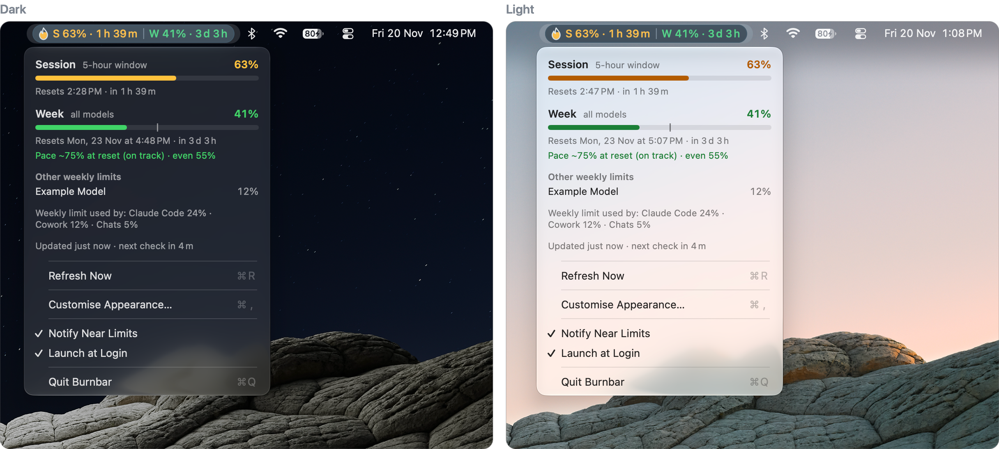
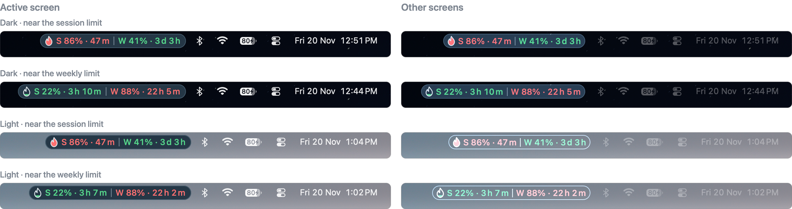
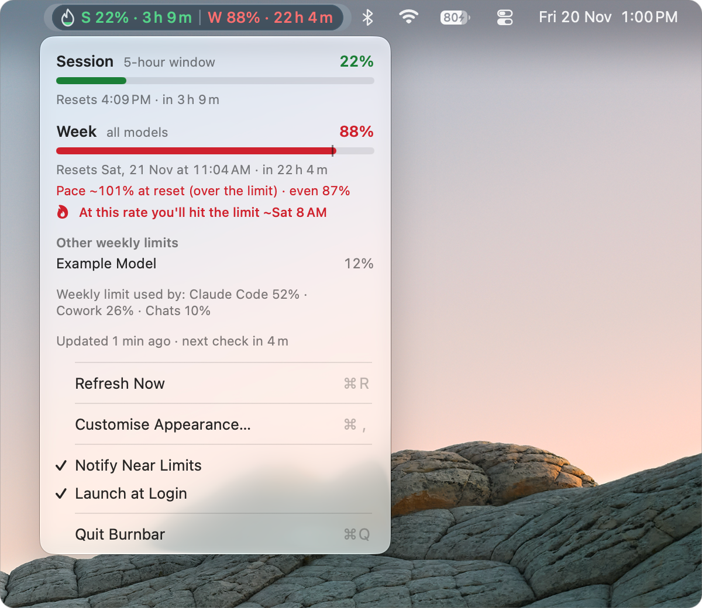
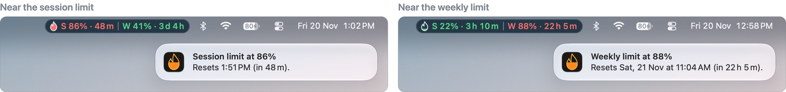
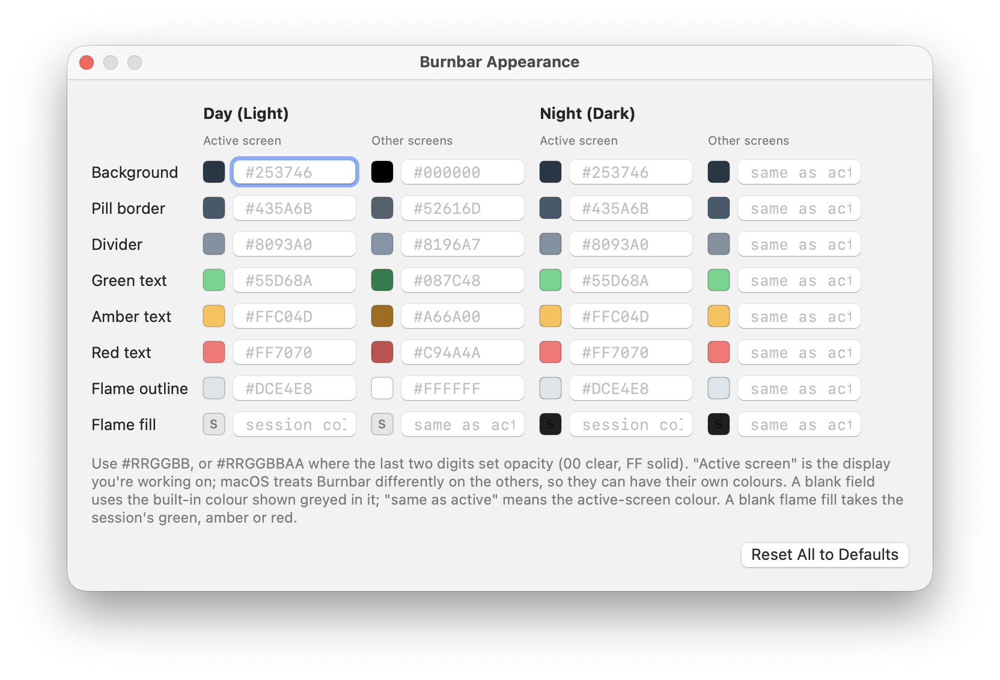

# Burnbar

A lightweight macOS menu bar app that shows how fast you're burning through your Claude
subscription limits: session and weekly usage with live reset countdowns, colour-coded by risk,
with a warning before you run out. No Claude tab needed just to check.



*Screenshots show sample usage, not a real account.*

```
🔥 S 42% · 4 h 50 m │ W 61% · 1 d 16 h
```

## Why

Claude plans have a rolling 5-hour session limit and a weekly limit. Checking them means opening
the usage page, and it's easy to run out mid-task without noticing. Burnbar keeps both numbers in
the menu bar, colours them by how close you are, and tells you when, at your current pace, you'd
hit the limit before it resets.

## Features

- **Session and week at a glance:** `S` (5-hour session) and `W` (7-day week) with countdowns to
  each reset, in a compact pill with a flame that fills with your session usage.
- **Colour by risk:**
  - **S:** green under 50 %, amber 50–80 %, red from 80 %.
  - **W:** coloured by *pace*, i.e. where you'll land by the reset at your average rate since the
    week began. Green under 80 %, amber 80–100 %, red from 100 % (or once 95 % is used). For the
    first 12 h after a reset, the session thresholds apply instead.
- **Forecast:** "At this rate you'll hit the limit ~Fri 9 PM", shown only when that's before the
  reset. Based on your recent usage (last hour for session, last 6 h for the week).
- **Dropdown details:** exact reset times, weekly pace against an even-pace marker, per-model
  weekly limits, which surfaces (Claude Code, chats, …) used the weekly limit, last update.
- **Battery-friendly refresh:** every 5 min on power and 15 min on battery (2 and 5 min when the
  session is at 80 % or more). Pauses while asleep or locked; countdowns tick locally.
- **Honest when stale:** if a fetch fails, values stay but turn grey and the dropdown shows their
  real age.
- **Optional notifications** at 80 % and 95 %, once per window. **Launch at login** is on by default.
- **Customisable colours** (Customise Appearance…, ⌘,), per Light/Dark theme and per screen.

### Near the limits

The pill on the screen you're working on, and on your other screens, where macOS draws menu bar
items more faintly:



The dropdown when the week is running hot, with the forecast:



And the notifications at 80 %:



## Requirements

- macOS 14 or later (the build's minimum). Developed and tested only on macOS 27 on Apple Silicon;
  the menu bar rendering details in [docs/DECISIONS.md](docs/DECISIONS.md) were measured there and
  may differ on other versions.
- Xcode Command Line Tools with **Swift 6.4 or newer** (`xcode-select --install`, then check
  `swift --version`). Full Xcode is not needed.
- Claude Code (Anthropic's command-line tool) installed and signed in with a Claude
  subscription (Pro or Max). Burnbar reads Claude Code's sign-in; it has no login of its own.

## Install

```bash
git clone https://github.com/anujith-singh/burnbar.git
cd burnbar
./install.sh
```

`install.sh` builds a release binary, wraps it in `Burnbar.app` (the icon is generated from code),
signs it ad hoc, installs it to `~/Applications` and launches it. Run it again to update after a
`git pull`.

On first launch macOS may ask whether Burnbar can send notifications, and will show that it was
added to your login items.

If the dropdown says **"Can't read your Claude usage"**, Claude Code's sign-in has expired: run
`claude` in Terminal once. Burnbar picks up the refreshed sign-in on its next check.

### Uninstall

Quit Burnbar from its menu, then:

```bash
rm -rf ~/Applications/Burnbar.app ~/Library/Application\ Support/Burnbar
defaults delete com.burnbar.Burnbar
```

Remove it from System Settings › General › Login Items if it's still listed.

## How it works

- **Data:** `GET https://api.anthropic.com/api/oauth/usage` with Claude Code's OAuth token. The
  endpoint is **undocumented**, so Burnbar parses it defensively and may break if it changes.
- **Sign-in, read-only:** the token is read from the macOS Keychain item `Claude Code-credentials`
  via `/usr/bin/security`. Burnbar **never refreshes or writes it**: refreshing would rotate the
  token and sign Claude Code out. When the token expires (about every 8 h if Claude Code isn't
  running), Burnbar waits for Claude Code to refresh it.
- **Refresh policy:** see Features. A fetch also runs once right after a reset time passes and on
  wake/unlock. Failed fetches retry at 30 s, 1, 2, 4 min; HTTP 429 backs off up to 30 min.

## Privacy

- Reads one Keychain item (Claude Code's sign-in) and talks to one host, `api.anthropic.com`.
- Stores the last 48 h of usage readings in `~/Library/Application Support/Burnbar/samples.json` to
  estimate your burn rate, and its settings in `com.burnbar.Burnbar` preferences.
- No analytics, no telemetry, no other network access. The token is never logged.

## Customising

**Customise Appearance…** (⌘, in the dropdown) sets any colour as hex (`#RRGGBB`, or `#RRGGBBAA`
with opacity), separately for Light and Dark, and for the active screen and your other screens.
Blank fields use the built-in colours; **Reset All to Defaults** restores them. The built-in sets
and why they differ by screen are in [docs/DECISIONS.md](docs/DECISIONS.md#7-colours).



## Development

```bash
swift build
swift test -Xswiftc -plugin-path -Xswiftc /Library/Developer/CommandLineTools/usr/lib/swift/host/plugins/testing
```

The extra flags are needed with the Command Line Tools: they ship Swift Testing's macro plugin in
a folder the build doesn't search. With full Xcode, plain `swift test` works.

- `Sources/BurnbarCore`: parsing, pace, forecasting and formatting, unit-tested.
- `Sources/Burnbar`: the AppKit/SwiftUI app.
- `Burnbar --snapshot <dir>` renders the menu bar item and the dropdown in Light and Dark to PNGs
  (offscreen, as on the active screen). Colour overrides can be passed as arguments, e.g.
  `-colour.day.background "#253746"`.
- `BURNBAR_FIXTURE=/path/to/response.json` reads a saved response instead of the network (a missing
  path simulates a failed fetch).
- Logs: `/usr/bin/log show --last 1h --predicate 'subsystem == "com.burnbar.Burnbar"'` (the full
  path matters in zsh, which has a `log` builtin).

## Design decisions

[docs/DECISIONS.md](docs/DECISIONS.md) explains why Burnbar is built the way it is: what was
measured on real menu bars (macOS draws a menu bar item once per screen, always with a dark
appearance, and washes out colours on the active screen), what was tried and rejected, and how the
layout and colours were chosen. Read it before changing the menu bar item.

## Disclaimer

Burnbar is an unofficial, independent project. It is not affiliated with or endorsed by Anthropic.
"Claude" and "Claude Code" are trademarks of Anthropic. It relies on an undocumented endpoint and on
Claude Code's stored sign-in; either may change at any time. Check Anthropic's terms before relying
on it.

## License

[MIT](LICENSE)
